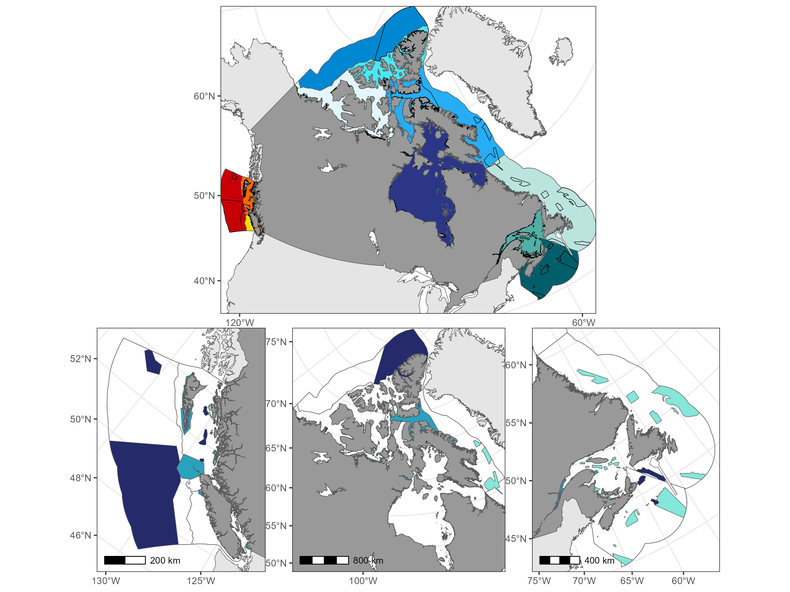
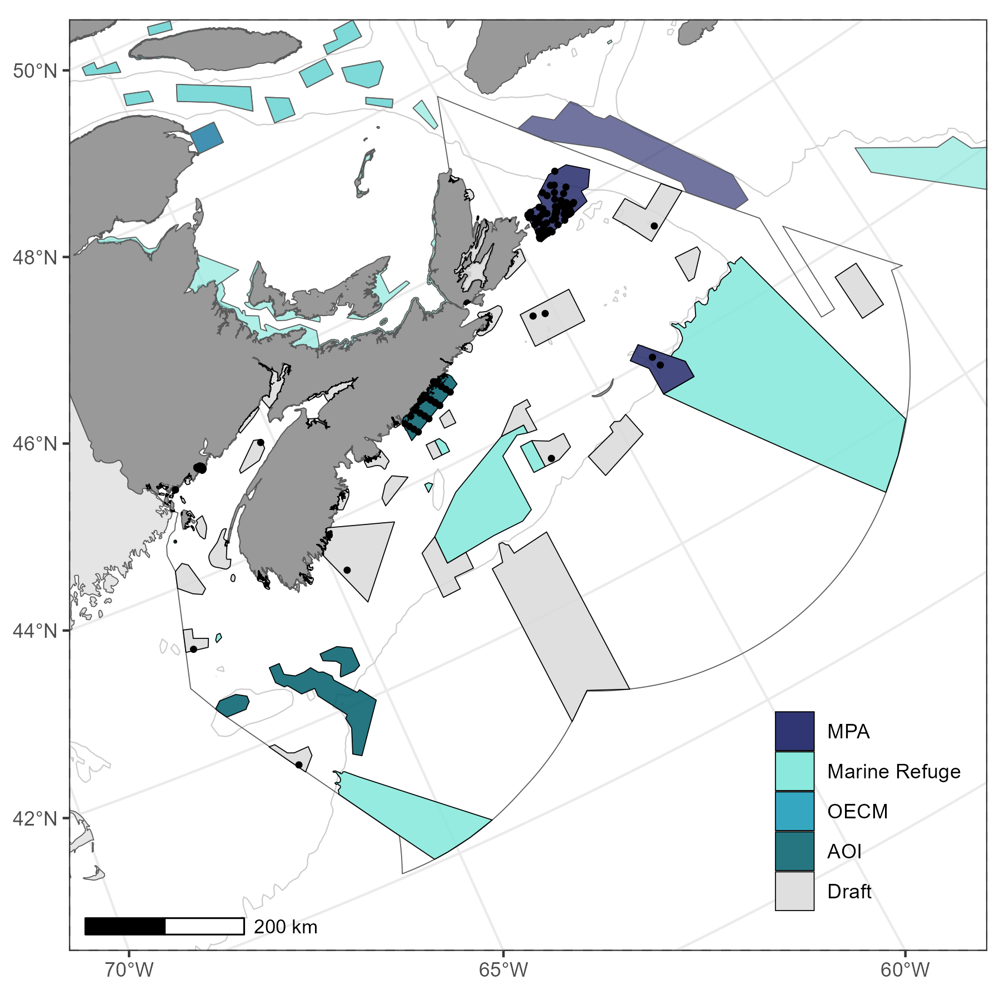
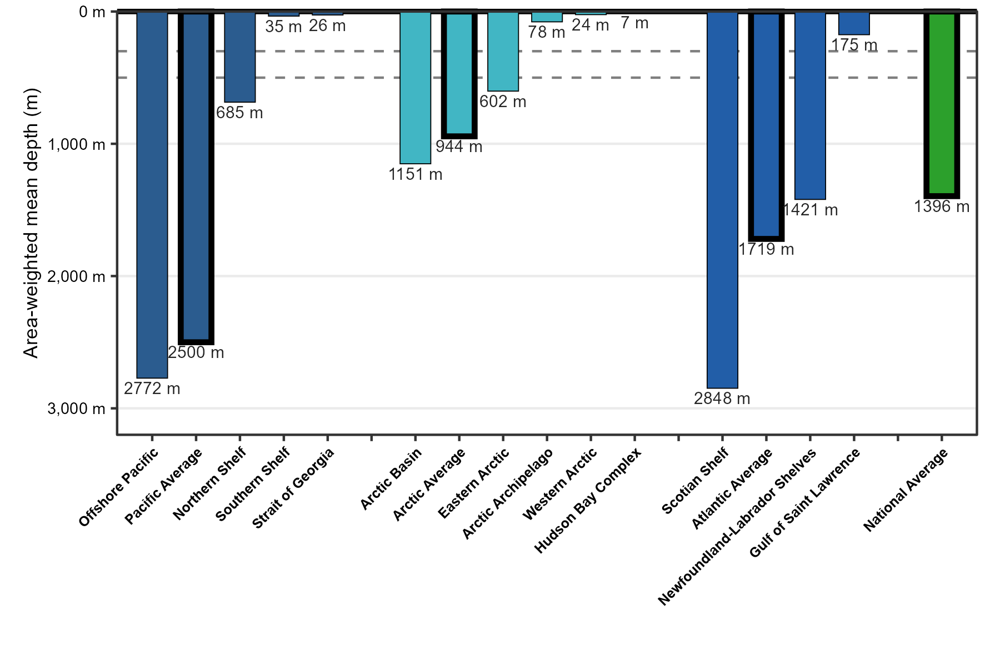
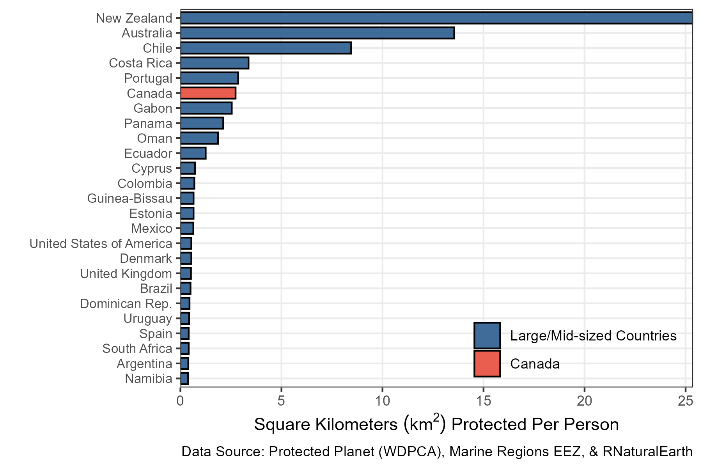

# Canadian_eDNA_MPA
Progress on Operationalizing eDNA Biomonitoring within Canadian Marine Conservation Areas

**Figure 1** - The Canadian Marine Conservation Network. Federal Marine Bioregions noted in the top panel, bottom panel depicts measures in the Pacific, Arctic, and Atlantic Oceans, with spatial conservation measures delineated to those under DFO jurisdiction (Oceans act MPAs and Fisheries Act Marine Refuges) and other spatial conservation measures denoted as OECMs implemented by other indigenous, federal, provincial, and territorial authorities. 

**Figure 2** - Scotian Shelf-Bay of Fundy conservation network eDNA sampling program

**Figure 3** - Area-weighted mean bathymetric depth across Canadian marine bioregions, inline ocean averages (indicated by bold outlines), and the national average (green). Bars are ordered from deepest to shallowest within each ocean region, with reference lines at 300" m"  and 500" m" .

**Figure 3** - Big mandate, per capita challenge: Per capita marine conservation commitment, calculated as the total area of established marine conservation areas relative to national population size. Conservation area coverage was obtained from Protected Planet, population estimates from the R package rnaturalearth, and exclusive economic zone (EEZ) areas from the Marine Regions database. The analysis was restricted to countries with populations exceeding one million to reduce the influence of small island states on per capita comparisons. The top 25 countries by this metric are shown.